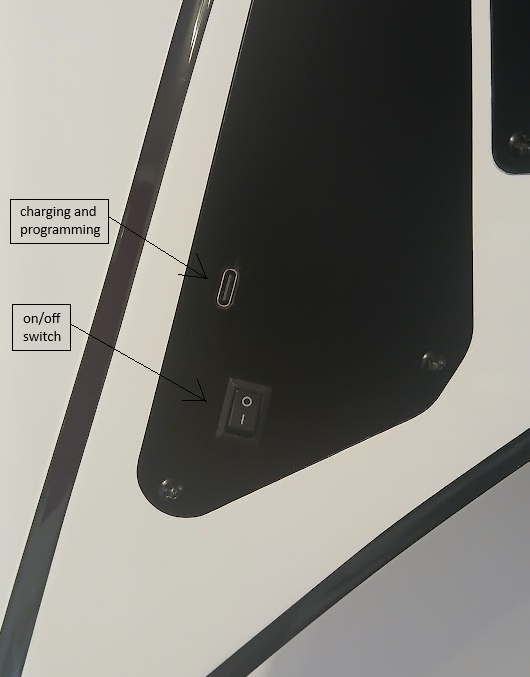
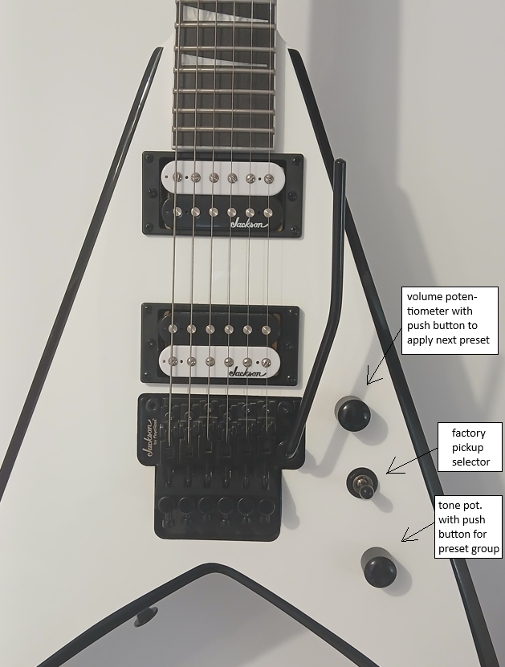

# Valeton GP5 In Guitar Switch

A project for switching the presets on Valeton GP5 multi-effects processor directly from your guitar.
Modifications made to the guitar includes:
- replacing volume and tone potentiometers with modified push-push potentiometers i.e. removing the pin that holds the potentiometer in pushed state, so it starts acting like a push button
- installing ESP32 C3 board for sending SysEx messages to the GP5 over BLE 

## Images

## How it works

The volume and tone push-push potentiometers are wired to the ESP32-C3 GPIO 4 and GPIO 5 and are used to switch to the next preset in current preset group, and to switch to the next preset group respectively.

## Hardware

- Seeed Studio XIAO ESP32C3 board
- 500 mAh LiPo battery (lasts at least 5 hours of operation)
- 2x 500k push-push potentiometers

## Serial Terminal PWA

The [sample web app](docs/index.html) is a USB serial terminal with an installable
[manifest](docs/manifest.json) and an offline [service worker](docs/sw.js).
It sends UTF-8 text and displays serial output; it does not implement GP5 commands,
BLE control, or firmware flashing. The connected firmware must support any commands
you send. The default baud rate is 115200 (8-N-1, no flow control).

### GitHub Pages

1. Push the `docs` folder, including its PNG assets, to GitHub.
2. In **Settings > Pages**, choose **Deploy from a branch**, select your branch,
	and choose **/docs** as the source folder.
3. Open `https://<owner>.github.io/<repository>/` in desktop Chrome or Edge.
4. Click **Connect device**, then select the USB serial port in the browser prompt.
	Close other serial monitors first so they do not hold the port open.
5. Install using **Install app** when offered, or the browser's install menu.

Web Serial requires HTTPS (or localhost), a supported browser, and explicit user
permission. Installing the PWA does not bypass those restrictions. Most mobile
browsers, Firefox, and Safari do not support Web Serial. Port permission is only
requested when you click Connect; the app never automatically reconnects.

### Local Preview

From the repository root, run `python -m http.server 8000 --directory docs`, then
open `http://localhost:8000/`. Opening the HTML directly with `file://` is not a
supported way to test the PWA. After the first successful online load, the app
shell is available offline; the USB device must still be connected for serial I/O.
The log is kept in memory (limited to 100,000 characters); use **Save log** to
download it before closing the app.

When updating cached assets, increment `CACHE_NAME` in the service worker. Close
all app tabs/windows and reopen to activate a newly installed worker.

## License

See LICENSE file for details.
