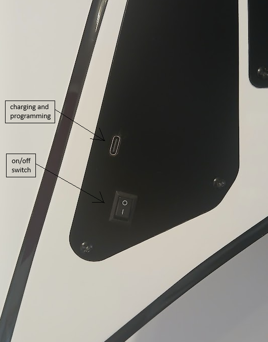
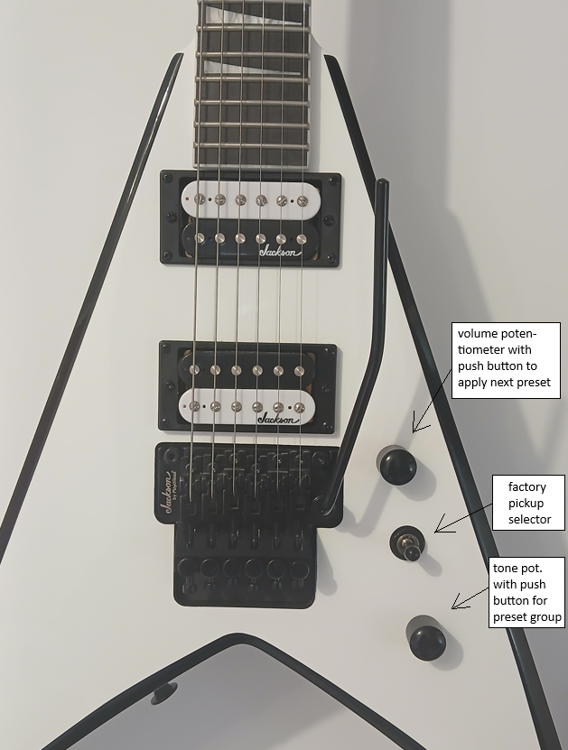

# Valeton GP5 In Guitar Switch

A project for switching the presets on Valeton GP5 multi-effects processor directly from your guitar.
Modifications made to the guitar includes:
- replacing volume and tone potentiometers with modified push-push potentiometers i.e. removing the pin that holds the potentiometer in pushed state, so it starts acting like a push button
- installing ESP32 C3 board for sending SysEx messages to the GP5 over BLE 

## Images

## How it works

The volume and tone push-push potentiometers are wired to the ESP32-C3 GPIO 4 and GPIO 5 and are used to switch to the next preset in current preset group, and to switch to the next preset group respectively.

### BLE preset messages

Preset changes use 24-byte BLE-MIDI SysEx packets, including the two-byte
`80 80` prefix and six trailing zero payload bytes before `F7`. The GP-5
characteristic is written without response, matching the working guitar-switch
implementation. The negotiated ATT MTU must be at least 27 so the complete
packet fits in one write; undersized MTUs and write failures are logged.
A successful write means the packet was queued, not that the GP-5 confirmed a
preset change.

Run the packet regression check with
`powershell -NoProfile -File .\test\gp5_packets.Tests.ps1`.

### BLE MIDI proxy

NimBLE registers the standard Generic Access (`1800`) and Generic Attribute
(`1801`) services before the application services. Generic Access exposes the
Device Name characteristic (`2A00`) with read and write access, matching the
GP-5's discovered GAP service; its value is `GP5 Proxy`, consistent with the
proxy's advertised name. The firmware also advertises a BLE MIDI service.
Connect a
BLE MIDI controller to it and enable notifications on the MIDI characteristic.
Writes (with or without response) are forwarded unchanged to the connected GP-5;
GP-5 notifications are forwarded unchanged as notifications to the controller.
The existing button-driven preset changes continue to write directly to the GP-5.

Both links must negotiate an ATT MTU large enough for each packet (packet length
plus three bytes). Packets are not split or truncated. Writes while the GP-5 is
disconnected, notifications without a connected/subscribed controller, oversized
packets, and transmission failures are logged. Controller writes are not buffered
or retried. GP-5 notifications and controller API replies enter a bounded FIFO
of 32 complete packets (up to 512 bytes each), drained up to five packets per main-loop
iteration, outside the BLE host callbacks. `Send` success means queued, not
delivered. Temporary host errors (`ENOMEM`, `EAGAIN`, `EBUSY`) retain the head packet
for retry; GP-5 packets expire ten seconds after enqueueing, within the browser's
12-second name-fetch deadline. Configuration API replies retain a two-second expiry
within their four-second request deadline. Queue overflow, expiry
and permanent errors are explicitly logged. Disconnecting or unsubscribing
invalidates queued packets so they cannot be sent to a later connection.
The batch stops immediately on a temporary host error, retaining FIFO order.
Discarded packets also count toward the five-packet limit. The main loop retains
its 20 ms delay between iterations.

Run the bidirectional proxy regression tests in a Visual Studio Developer
PowerShell with C++ tools installed:
`powershell -NoProfile -File .\test\ble_proxy.Tests.ps1`.
These compile the actual BLE classes against test doubles; radio-level behavior
still requires testing with a GP-5 and BLE MIDI controller.

## Hardware

- Seeed Studio XIAO ESP32C3 board
- 500 mAh LiPo battery (lasts at least 5 hours of operation)
- 2x 500k push-push potentiometers

## Preset Manager PWA

The [single-page preset manager](docs/index.html) uses Web Bluetooth with an
installable [manifest](docs/manifest.json) and offline [service worker](docs/sw.js).
Flash the updated ESP32-C3 firmware before using load/save. The page connects to
`GP5 Proxy`, subscribes to the custom configuration and BLE MIDI characteristics, and automatically loads
the controller's action list and requests GP-5 preset names. Bluetooth permission
requires a click on **Connect**; requests cannot run before that.

The dark-themed mobile workspace keeps **Reload** and **Save** on one row.
Tap a group heading to expand its actions; navigation destinations show group
and slot side by side. **Reload** loads the controller's groups and refreshes
the GP-5 preset names.
The action list stops after the first **Navigate**, regardless of destination,
including that navigation action. Later slots remain stored and are revealed
if you change that action to **Preset change** (up to the next **Navigate**).
The group badge counts visible slots.

The map has 12 normal groups and four extended groups, each with eight fixed slots.
Supported entries:

- **Preset change:** select a GP-5 preset from index **0 through 99**, inclusive.
- **Navigate:** select any group (0-15) and slot (0-7). One navigation hop is
  followed; if the destination is also navigation, no MIDI message is sent and
  the current position remains at that destination.

The group button advances among normal groups; an entry may navigate elsewhere.
The two long presses select extended groups 1 and 2. Advancing past slot 8 wraps
to slot 1. Slots and groups cannot be inserted/deleted because navigation uses
fixed indexes. **Save** validates and commits the complete map in one request.
The active configuration changes only after a successful commit and survives reboot;
factory defaults are used when no saved configuration exists. Save does not alter
the GP-5's sound presets. Failed saves retain the page's unsaved edits.
**Reload** discards edits after confirmation.

The name fetch sends the GP-5 sync packet
`80 80 F0 00 0E 00 01 00 00 00 02 01 02 04 00 F7`, then the name-list request
`80 80 F0 03 05 00 01 00 00 00 02 01 02 02 04 F7`.
Every name fetch, including refresh, waits 100 ms between these commands to
let the GP-5 enter sync mode. Sending only the name-list request is insufficient.
The response contains five nibble-encoded names per 212-byte notification;
all 100 entries must arrive within 12 seconds. Malformed, incomplete or failed
fetches display **only preset indexes**, with an explicit warning, not invented
names. The 16-byte end-of-list marker is informational, not an error or proof
that all names reached the browser; loading waits for all 100 names or the
deadline. Timeout errors include the received count and missing indexes.
Both BLE links need an ATT MTU of at least **215** for these notifications;
the configured preferred MTU is 256. The GP-5 must be connected to the proxy.
The GP-5 client keeps a **15 ms connection interval** (12 BLE interval units)
both during connection setup and in its post-connect update. Changing that
update to 120 units (150 ms) caused missing patch-name batches before they
reached the ESP32 in hardware testing. The 15 ms setting recovered all 20
batches on connect and repeated refreshes; it favors reliable bursts over
the lower activity of a 150 ms interval.
Serial logs identify each patch-name batch at reception, queueing and forwarding,
without a full 212-byte hex dump inside the receive callback. Compare these
batch indexes with browser notifications to locate losses on either link.
The protocol reference is the community
[GP-5 Web Controller](https://github.com/helvecioneto/gp5-wc).

### Binary configuration protocol (version 1)

Custom service: `9c7b1000-6e4d-4f42-9a31-2d5e8b0c7f60`.
Custom characteristic: `9c7b1001-6e4d-4f42-9a31-2d5e8b0c7f60` (WRITE and NOTIFY).
Discover this service explicitly; advertising retains the existing MIDI/GP-5
identifiers. Configuration traffic never uses MIDI characteristics.

Requests: `01 <command> <token> <payload>`.
Responses: `01 <command> <token> <status> <payload>`.
All fields are raw eight-bit bytes; there are no SysEx delimiters, escaping,
checksums, or separate length fields. GATT supplies packet boundaries.
Status is `0` success, `1` invalid request/version/length, `2` invalid configuration,
or `3` flash failure. Command and token are echoed, including tokens above 127.
Send one request at a time using a write with response, subscribe before sending,
and wait for the response notification (the UI deadline is four seconds).
The GATT write acknowledgement is not the configuration commit acknowledgement.

| Command (hex) | Request payload | Success response payload |
| --- | --- | --- |
| `01` read configuration | empty | complete 128-byte map |
| `04` write configuration | complete 128-byte map | empty |

Errors have no payload. Map order is group-major: groups 0-15, slots 0-7.
Each byte with bit 7 set selects GP-5 preset `entry & 127` (valid range 0-99).
Otherwise it navigates to group `entry & 15`, slot `(entry >> 4) & 7`.
The maximum request is 131 bytes; the maximum response is 132 bytes.
Both fit one GATT message at **MTU >=135**; smaller MTUs are rejected before
processing requests. The preferred MTU is 256. No fragmentation is used.
Successful writes commit to NVS before replacing the active map and resetting
the current position to group 0, slot 0. MIDI remains an unchanged GP-5 proxy,
including traffic resembling the retired private SysEx protocol.

Run browser-independent UI/protocol regressions with
`node --test .\test\preset_ui.Tests.cjs`. The native
`powershell -NoProfile -File .\test\ble_proxy.Tests.ps1` suite also tests preset
validation, flash persistence and separate-characteristic routing using test
doubles. Actual GP-5/radio interoperability still requires hardware testing.

If **Reload** logs a notification failure, inspect its return code.
`rc=6` is `BLE_HS_ENOMEM` (host buffer exhaustion), not an MTU error. Sending
from the incoming BLE callback can exhaust buffers during the 20-packet name-list
burst; blocking/retrying there also prevents the host from releasing buffers.
The FIFO/main-loop path lets the host continue running while pending sends retry.
The MSYS_1 pool has 32 blocks (rather than the default 12), giving the 20-packet
name-list burst headroom while the proxy services both BLE links. The browser link
requests a 15-30ms connection interval with zero peripheral latency; the central
may choose different parameters, so actual interval and latency are logged at
subscription time.
`MIDI notification deferred` records temporary pressure; `Deferred MIDI notification
sent` records recovery. No packets are split or reordered. NimBLE
C++ error logging is enabled in the build flags so the actual stack error is
visible. The proxy logs notification length, connection handle and negotiated MTU,
as well as subscription changes and nonzero notification status codes. A generic
forwarding failure alone does not establish buffer exhaustion or an MTU problem;
an oversized packet has a separate explicit MTU error. Capture the logs from
connection/subscription through the failed refresh when reporting this issue.

### GitHub Pages

1. Push the `docs` folder, including its PNG assets, to GitHub.
2. In **Settings > Pages**, choose **Deploy from a branch**, select your branch,
	and choose **/docs** as the source folder.
3. Open `https://<owner>.github.io/<repository>/` in desktop Chrome or Edge.
4. Click **Connect**, then select `GP5 Proxy` in the browser prompt.
   Keep the GP-5 powered on and connected to the ESP32-C3.
5. Install using **Install app** when offered, or the browser's install menu.

Web Bluetooth requires HTTPS (or localhost), a supported browser, and explicit user
permission. Installing the PWA does not bypass those restrictions. Most mobile
browsers, Firefox, and Safari do not support Web Bluetooth. Chrome on Android is
supported; iOS browsers are not. Device permission is only
requested when you click Connect; the app never automatically reconnects.

### Local Preview

From the repository root, run `python -m http.server 8000 --directory docs`, then
open `http://localhost:8000/`. Opening the HTML directly with `file://` is not a
supported way to test the PWA. After the first successful online load, the app
shell is available offline; Bluetooth and the controller are still required for
device I/O. Edits are kept in page memory until saved to the controller; reconnecting
loads the controller configuration after a discard confirmation.

When updating cached assets, increment `CACHE_NAME` in the service worker. Close
all app tabs/windows and reopen to activate a newly installed worker.

## License

See LICENSE file for details.
